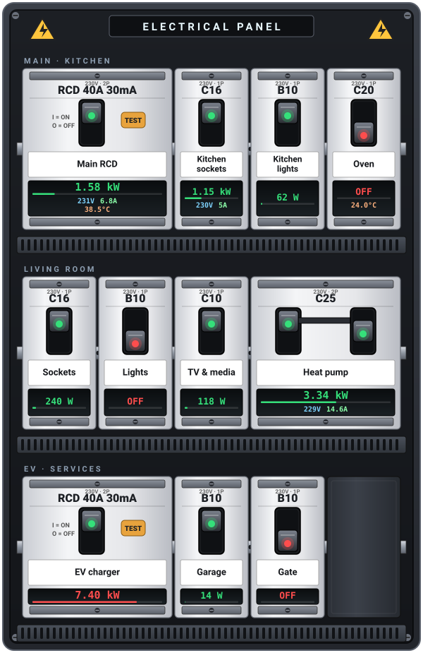
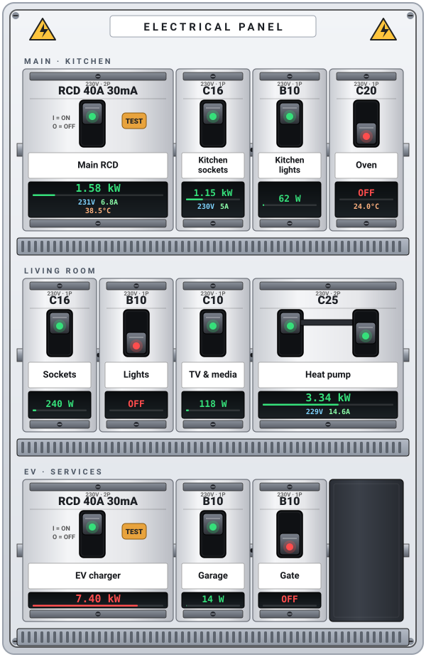

# Electrical Panel Card

🇬🇧 English · [🇷🇴 Română](README.ro.md)

[](https://github.com/hacs/integration)
[](https://github.com/jello1974/electrical-panel-card/actions/workflows/validate.yml)

A realistic **electrical panel** card for Home Assistant. Your breakers, RCDs, main switch and meter are drawn in SVG on DIN rails, with moving handles, LCD readouts and a **full visual editor** — no YAML required.



<details><summary>Light theme</summary>



</details>

## Features

- 🧰 **Visual editor**: add rows, add/move/duplicate/delete modules, pick entities — all from the UI.
- 🔌 **Module models**: 1P / 2P / 3P / 4P circuit breakers, RCBO, 2P / 4P RCD, main switch, meter display, blank cover.
- 🕹️ **Live handles**: the lever moves and the LED changes colour with the switch state (on / off / unavailable).
- 📟 **LCD per module**: power (W / kW) or current (A), plus a usage bar that turns yellow / red.
- ⚡ **Optional sensors** per module: voltage, current and temperature — shown only when set.
- 🧮 **Automatic limits**: max power is computed from *voltage × current rating* (×√3 for 3-phase) — or set your own thresholds.
- 🛡️ **Safety**: optional confirmation dialog before switching (globally or per breaker), read-only mode, long-press for details.
- 🌍 **English, Romanian, and French**, auto-detected from Home Assistant's language (or forced with `language:`).
- 🎨 Dark and light panel themes; responsive SVG that scales with the card.
- 📦 No dependencies (no button-card, no card-mod).

## Installation

### HACS (recommended)

[](https://my.home-assistant.io/redirect/hacs_repository/?owner=jello1974&repository=electrical-panel-card&category=plugin)

1. Open **HACS** in Home Assistant, search for **Electrical Panel Card**, and click **Download** (or click the **Open in My Home Assistant** button above).
2. Reload your browser (hard refresh).

<details><summary>Fallback: Manual installation via Custom Repository</summary>

If the card does not appear in HACS search yet:
1. Open **HACS → ⋮ → Custom repositories**.
2. Add `https://github.com/jello1974/electrical-panel-card` with category **Dashboard** (also called *Lovelace*).
3. Search for **Electrical Panel Card**, click **Download**, then reload your browser (hard refresh).

</details>

> HACS adds the dashboard resource automatically. If you use YAML mode for resources, add:
> ```yaml
> resources:
>   - url: /hacsfiles/electrical-panel-card/electrical-panel-card.js
>     type: module
> ```


### Manual

1. Download `electrical-panel-card.js` from the [latest release](https://github.com/jello1974/electrical-panel-card/releases/latest) and copy it to `/config/www/`.
2. **Settings → Dashboards → ⋮ → Resources → Add resource**: URL `/local/electrical-panel-card.js`, type **JavaScript module**.
3. Hard-refresh the browser. To bypass the cache after an update use `/local/electrical-panel-card.js?v=2`, `?v=3`, …

## Usage

**Edit dashboard → Add card → “Electrical Panel Card”** and use the visual editor:

1. In **General settings** choose title, theme, language, LCD mode and options.
2. Add a **row**, give it a label, then **+ Add module** and pick a model.
3. Click a module in the strip to edit it: name, current rating, voltage, curve, switch entity, consumption sensor, optional voltage / current / temperature sensors, thresholds.

Everything is also available in YAML — see [`examples/example.yaml`](examples/example.yaml).

```yaml
type: custom:electrical-panel-card
language: auto            # auto | en | ro | fr
theme: dark               # dark | light
columns: 5                # modules per rail (empty = auto)
confirm: false            # ask before switching any breaker
rows:
  - label: Main · Kitchen
    modules:
      - model: rcd2
        name: Main RCD
        entity: switch.main_rcd
        power: sensor.house_power
        amps: 40
        sensitivity: 30
        voltage: 230
        confirm_off: true
      - model: mcb1
        name: Kitchen sockets
        entity: switch.kitchen_sockets
        power: sensor.kitchen_sockets_power
        curve: C
        amps: 16
        voltage: 230
        voltage_sensor: sensor.kitchen_voltage   # optional
        current_sensor: sensor.kitchen_current   # optional
        temp_sensor: sensor.kitchen_breaker_temp # optional
```

## Options

### Card

| Option | Default | Description |
|---|---|---|
| `rows` | – | **Required.** List of rows (see below). |
| `title` | translated | Title on the top plate. |
| `language` | `auto` | `auto` (Home Assistant language), `en`, `ro`, `fr`. |
| `theme` | `dark` | `dark` or `light`. |
| `columns` | auto | Modules per rail. Auto = longest row. |
| `max` | `6000` | Default max power (W) for modules without a current rating. |
| `display` | `power` | LCD mode: `power` (W/kW) or `current` (A). |
| `show_title` | `true` | Show the title plate. |
| `show_ducts` | `true` | Draw cable ducts between rails. |
| `show_lcd` | `true` | Show the LCD window on each module. |
| `show_ratings` | `true` | Show the rating text (e.g. `C16`). |
| `fill_blanks` | `true` | Fill incomplete rails with blank covers. |
| `readonly` | `false` | Tap opens details instead of switching. |
| `confirm` | `false` | Ask for confirmation before switching (all breakers). |

### Row

| Option | Description |
|---|---|
| `label` | Engraved caption above the rail. |
| `modules` | List of modules. |

### Module

| Option | Description |
|---|---|
| `model` | `mcb1`, `mcb2`, `mcb3`, `mcb4`, `rcbo`, `rcd2`, `rcd4`, `main`, `meter`, `blank`. |
| `name` | Text on the label plate (`\n` for a new line). |
| `entity` | Entity to switch (`switch`, `light`, `input_boolean`, `fan`). |
| `power` | Consumption sensor (W or kW). For `meter`: total power. |
| `energy` | *(meter)* Energy sensor shown under the power. |
| `voltage_sensor` / `current_sensor` / `temp_sensor` | Optional sensors, shown in the LCD only when set. |
| `curve` | Trip curve `B`, `C` or `D`. |
| `amps` | Current rating (A). Drives rating text and max power. |
| `voltage` | Nominal voltage (V). Default 230 (400 for 3P/4P). |
| `sensitivity` | *(RCD/RCBO)* Residual current (mA). |
| `poles` / `slots` | Override the number of poles / slots occupied. |
| `rating` | Override the rating text. |
| `max`, `yellow`, `red` | Override max power and warning thresholds (W). |
| `temp_yellow`, `temp_red` | Temperature thresholds (°C). Default 60 / 80. |
| `display` | Override the LCD mode for this module. |
| `handle_color` | Lever colour (hex). |
| `tap_action` | `toggle` (default), `more-info` or `none`. |
| `confirm` | `true` / `false` – override the card-level confirmation. |
| `confirm_off` | `true` – ask only when turning **off**. |

### Models

| Model | Description | Slots |
|---|---|---|
| `mcb1` / `mcb2` / `mcb3` / `mcb4` | Circuit breaker 1P / 2P / 3P / 4P | 1 / 2 / 3 / 4 |
| `rcbo` | RCBO (1P+N) with TEST button | 2 |
| `rcd2` / `rcd4` | Residual-current device 2P / 4P | 2 / 4 |
| `main` | Main switch (orange handle) | 2 |
| `meter` | Large LCD with total power and optional energy | 2 |
| `blank` | Blank cover | 1 |

## How limits and colours work

- **Max power** = `voltage × amps` (×√3 for 3P/4P). Without `amps` the card-level `max` is used. Override with `max`.
- **Usage bar / colour**: green below 60 %, yellow from 60 %, red from 80 % of max — or your own `yellow` / `red`.
- **Voltage** turns yellow at ±10 % and red at ±15 % from nominal.
- **Current** turns yellow at 80 % and red at 100 % of `amps`.
- **Temperature** turns yellow at 60 °C and red at 80 °C by default (°F and K sensors are converted).
- Without a power sensor, **1P/2P** modules compute power as *voltage sensor × current sensor*.
- Rows where any module has extra sensors get a taller LCD; content is vertically centred.

## Troubleshooting

- **“Visual editor not supported”** – the browser still has an old copy of the file. Hard-refresh, or add `?v=N` to the resource URL. The console should print `ELECTRICAL-PANEL-CARD v1.x`.
- **Card not found / “Custom element doesn't exist”** – the resource is missing; check **Settings → Dashboards → Resources**.
- **Entity picker shows a plain text field** – it falls back to a text input with suggestions; typing the entity id works the same.

## Translations

Translations live in the `I18N` object at the top of [`dist/electrical-panel-card.js`](dist/electrical-panel-card.js). To add a language, copy the `en` block, translate the values (keep the keys), run `node scripts/check-i18n.js`, and open a pull request. The language appears automatically in the editor.

## Development

```bash
node scripts/check-i18n.js        # translation key parity
node scripts/generate-preview.js  # regenerate docs/preview*.svg
```

Releases: bump `VERSION` in the JS and `CHANGELOG.md`, commit, then `git tag v1.0.1 && git push --tags` — the *Release* workflow publishes the file for HACS.

## License

MIT — see [LICENSE](LICENSE).
