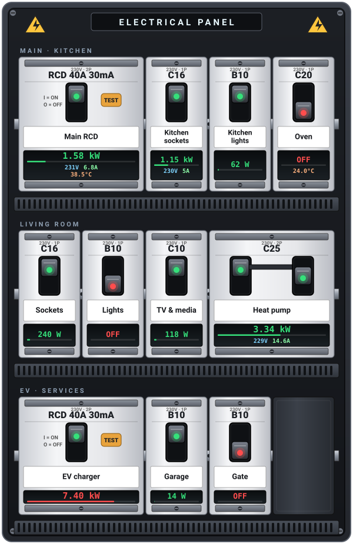
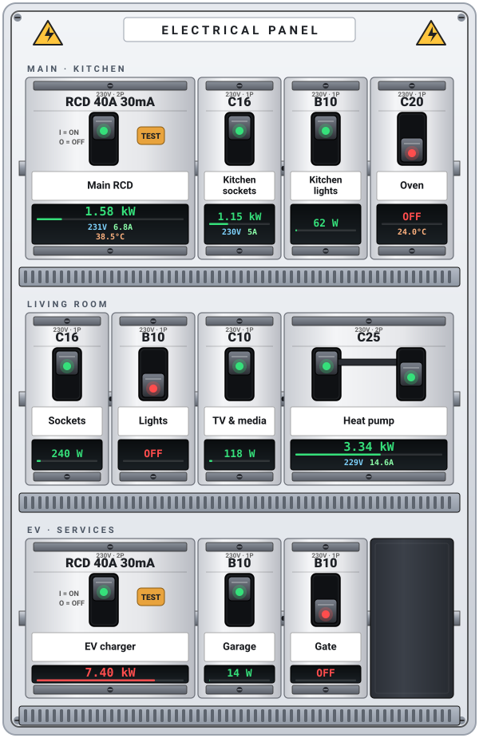

# Electrical Panel Card

[🇬🇧 English](README.md) · 🇷🇴 Română

[](https://github.com/hacs/integration)
[](https://github.com/jello1974/electrical-panel-card/actions/workflows/validate.yml)

Card pentru Home Assistant care desenează un **tablou electric realist**: siguranțe, diferențiale, întrerupător general și contor, în SVG, pe șine DIN, cu manete care se mișcă, ferestre LCD și un **editor vizual complet** — fără YAML.



<details><summary>Temă luminoasă</summary>



</details>

## Funcții

- 🧰 **Editor vizual**: adaugi rânduri, adaugi/muți/duplici/ștergi module, alegi entitățile — totul din interfață.
- 🔌 **Modele de module**: siguranțe automate 1P / 2P / 3P / 4P, RCBO, diferențial 2P / 4P, întrerupător general, contor, capac gol.
- 🕹️ **Manete în timp real**: maneta se mută, iar LED-ul își schimbă culoarea după starea comutatorului (pornit / oprit / indisponibil).
- 📟 **LCD pe fiecare modul**: putere (W / kW) sau curent (A), plus o bară de încărcare care devine galbenă / roșie.
- ⚡ **Senzori opționali** pe modul: tensiune, curent și temperatură — apar doar dacă sunt setați.
- 🧮 **Limite automate**: puterea maximă se calculează din *tensiune × amperaj* (×√3 la trifazat) — sau îți setezi propriile praguri.
- 🛡️ **Siguranță**: fereastră de confirmare înainte de comutare (global sau per siguranță), mod doar citire, apăsare lungă pentru detalii.
- 🌍 **Română, engleză și franceză**, detectate automat după limba din Home Assistant (sau forțate cu `language:`).
- 🎨 Teme întunecată și luminoasă; SVG responsive care se scalează cu cardul.
- 📦 Fără dependențe (nu cere button-card sau card-mod).

## Instalare

### HACS (recomandat)

[](https://my.home-assistant.io/redirect/hacs_repository/?owner=jello1974&repository=electrical-panel-card&category=plugin)

1. Deschide **HACS** în Home Assistant, caută **Electrical Panel Card** și apasă **Descarcă** (sau apasă pe butonul **Open in My Home Assistant** de mai sus).
2. Reîncarcă browserul (refresh forțat).

<details><summary>Alternativă: Instalare manuală prin Custom Repository</summary>

Dacă cardul nu apare încă la căutare în HACS:
1. Deschide **HACS → ⋮ → Depozite personalizate** (*Custom repositories*).
2. Adaugă `https://github.com/jello1974/electrical-panel-card` cu categoria **Dashboard** (numită și *Lovelace*).
3. Caută **Electrical Panel Card**, apasă **Descarcă**, apoi reîncarcă browserul (refresh forțat).

</details>

> HACS adaugă resursa automat. Dacă folosești resurse în mod YAML, adaugă:
> ```yaml
> resources:
>   - url: /hacsfiles/electrical-panel-card/electrical-panel-card.js
>     type: module
> ```
``


### Manual

1. Descarcă `electrical-panel-card.js` din [ultima versiune](https://github.com/jello1974/electrical-panel-card/releases/latest) și copiază-l în `/config/www/`.
2. **Setări → Tablouri de bord → ⋮ → Resurse → Adaugă resursă**: URL `/local/electrical-panel-card.js`, tip **JavaScript module**.
3. Refresh forțat în browser. După o actualizare, ca să ocolești cache-ul, folosește `/local/electrical-panel-card.js?v=2`, `?v=3` etc.

## Utilizare

**Editare tablou de bord → Adaugă card → „Electrical Panel Card”**, apoi folosește editorul vizual:

1. La **Setări generale** alegi titlul, tema, limba, modul LCD și opțiunile.
2. Adaugi un **rând**, îi dai o etichetă, apoi **+ Adaugă modul** și alegi un model.
3. Apeși pe un modul din bandă ca să-l editezi: nume, amperaj, tensiune, curbă, entitatea de comutare, senzorul de consum, senzorii opționali de tensiune / curent / temperatură, pragurile.

Totul se poate seta și în YAML — vezi [`examples/example.ro.yaml`](examples/example.ro.yaml).

```yaml
type: custom:electrical-panel-card
language: ro             # auto | en | ro | fr
theme: dark              # dark | light
columns: 5               # module pe șină (gol = auto)
confirm: false           # întreabă înainte de comutare (toate siguranțele)
rows:
  - label: General · Bucătărie
    modules:
      - model: rcd2
        name: Diferențial casă
        entity: switch.diferential_casa
        power: sensor.putere_casa
        amps: 40
        sensitivity: 30
        voltage: 230
        confirm_off: true
      - model: mcb1
        name: Prize bucătărie
        entity: switch.prize_bucatarie
        power: sensor.consum_prize_bucatarie
        curve: C
        amps: 16
        voltage: 230
        voltage_sensor: sensor.tensiune_bucatarie   # opțional
        current_sensor: sensor.curent_bucatarie     # opțional
        temp_sensor: sensor.temperatura_siguranta   # opțional
```

## Opțiuni

### Card

| Opțiune | Implicit | Descriere |
|---|---|---|
| `rows` | – | **Obligatoriu.** Lista de rânduri (vezi mai jos). |
| `title` | tradus | Titlul de pe placa de sus. |
| `language` | `auto` | `auto` (limba din Home Assistant), `en`, `ro`, `fr`. |
| `theme` | `dark` | `dark` sau `light`. |
| `columns` | auto | Module pe șină. Auto = cel mai lung rând. |
| `max` | `6000` | Puterea maximă implicită (W) pentru module fără amperaj. |
| `display` | `power` | Mod LCD: `power` (W/kW) sau `current` (A). |
| `show_title` | `true` | Afișează placa cu titlul. |
| `show_ducts` | `true` | Desenează canalele de cabluri între șine. |
| `show_lcd` | `true` | Afișează fereastra LCD pe fiecare modul. |
| `show_ratings` | `true` | Afișează amperajul (ex. `C16`). |
| `fill_blanks` | `true` | Completează șinele incomplete cu capace goale. |
| `readonly` | `false` | Atingerea deschide detaliile în loc să comute. |
| `confirm` | `false` | Cere confirmare înainte de comutare (toate siguranțele). |

### Rând

| Opțiune | Descriere |
|---|---|
| `label` | Text gravat deasupra șinei. |
| `modules` | Lista de module. |

### Modul

| Opțiune | Descriere |
|---|---|
| `model` | `mcb1`, `mcb2`, `mcb3`, `mcb4`, `rcbo`, `rcd2`, `rcd4`, `main`, `meter`, `blank`. |
| `name` | Textul de pe plăcuță (`\n` pentru rând nou). |
| `entity` | Entitatea de comutat (`switch`, `light`, `input_boolean`, `fan`). |
| `power` | Senzor de consum (W sau kW). La `meter`: puterea totală. |
| `energy` | *(contor)* Senzor de energie afișat sub putere. |
| `voltage_sensor` / `current_sensor` / `temp_sensor` | Senzori opționali, afișați în LCD doar dacă sunt setați. |
| `curve` | Curba de declanșare `B`, `C` sau `D`. |
| `amps` | Amperaj (A). Determină textul de pe modul și puterea maximă. |
| `voltage` | Tensiune nominală (V). Implicit 230 (400 la 3P/4P). |
| `sensitivity` | *(RCD/RCBO)* Curent diferențial (mA). |
| `poles` / `slots` | Suprascrie numărul de poli / sloturi ocupate. |
| `rating` | Suprascrie textul de amperaj. |
| `max`, `yellow`, `red` | Suprascriu puterea maximă și pragurile de avertizare (W). |
| `temp_yellow`, `temp_red` | Praguri de temperatură (°C). Implicit 60 / 80. |
| `display` | Suprascrie modul LCD pentru acest modul. |
| `handle_color` | Culoarea manetei (hex). |
| `tap_action` | `toggle` (implicit), `more-info` sau `none`. |
| `confirm` | `true` / `false` – suprascrie confirmarea de la nivel de card. |
| `confirm_off` | `true` – întreabă doar la **oprire**. |

### Modele

| Model | Descriere | Sloturi |
|---|---|---|
| `mcb1` / `mcb2` / `mcb3` / `mcb4` | Siguranță automată 1P / 2P / 3P / 4P | 1 / 2 / 3 / 4 |
| `rcbo` | RCBO (1P+N) cu buton TEST | 2 |
| `rcd2` / `rcd4` | Diferențial 2P / 4P | 2 / 4 |
| `main` | Întrerupător general (mâner portocaliu) | 2 |
| `meter` | LCD mare cu puterea totală și energie opțională | 2 |
| `blank` | Capac gol | 1 |

## Cum funcționează limitele și culorile

- **Puterea maximă** = `tensiune × amperaj` (×√3 la 3P/4P). Fără `amps` se folosește `max` de la nivel de card. Se poate suprascrie cu `max`.
- **Bara / culoarea de consum**: verde sub 60 %, galben de la 60 %, roșu de la 80 % din maxim — sau `yellow` / `red` proprii.
- **Tensiunea** devine galbenă la ±10 % și roșie la ±15 % față de nominal.
- **Curentul** devine galben la 80 % și roșu la 100 % din `amps`.
- **Temperatura** devine galbenă la 60 °C și roșie la 80 °C implicit (senzorii în °F și K se convertesc).
- Fără senzor de putere, modulele **1P/2P** calculează puterea ca *senzor tensiune × senzor curent*.
- Rândurile în care cel puțin un modul are senzori suplimentari au LCD mai înalt; conținutul se centrează vertical.

## Depanare

- **„Editorul vizual nu este acceptat”** – browserul are încă o copie veche a fișierului. Fă refresh forțat sau adaugă `?v=N` la URL-ul resursei. În consolă ar trebui să apară `ELECTRICAL-PANEL-CARD v1.x`.
- **Card negăsit / „Custom element doesn't exist”** – lipsește resursa; verifică **Setări → Tablouri de bord → Resurse**.
- **Selectorul de entități apare ca simplu câmp text** – folosește un câmp text cu sugestii; scrierea id-ului entității funcționează la fel.

## Traduceri

Traducerile se află în obiectul `I18N` de la începutul fișierului [`dist/electrical-panel-card.js`](dist/electrical-panel-card.js). Pentru o limbă nouă, copiază blocul `en`, tradu valorile (păstrează cheile), rulează `node scripts/check-i18n.js` și deschide un pull request. Limba apare automat în editor.

## Dezvoltare

```bash
node scripts/check-i18n.js        # verifică același set de chei în toate limbile
node scripts/generate-preview.js  # regenerează docs/preview*.svg
```

Publicare: crești `VERSION` în JS și `CHANGELOG.md`, faci commit, apoi `git tag v1.0.1 && git push --tags` — workflow-ul *Release* publică fișierul pentru HACS.

## Licență

MIT — vezi [LICENSE](LICENSE).
